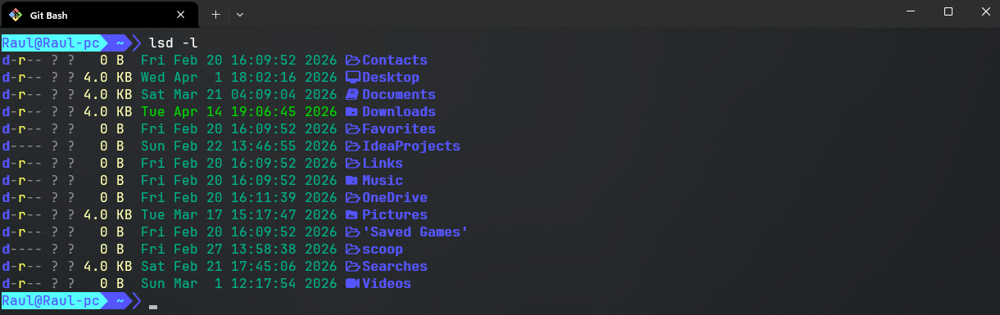

## Co to windows terminal

Jest to aplikacja pozwalająca nam na obsługę różnych powłok wiersza poleceń w systemie Windows. Jest to nasze centrum dowodzenia, w którym możemy jednocześnie mieć otwary windowsowy powershell, git basha jak i WSL.

Cechy Windows Terminal:

* Wielozadaniowość - możemy obsługiwać kilka kart i różne powłoki
* Możliwości personalizacji - zarówno wyglądu jak i skrótów klawiszowych
* Wspiera renderowanie tekstu przez GPU
* Łatwa konfiguracja - wszystko odbywa się w pliku JSON (niektóre funkcje nawet poprzez GUI)
* Jest nieco bardziej zasobożerny niż standardowy cmd

## Moja konfiguracja Windows Terminal

### 0. Git Bash oraz Git

Dla mnie totalny must have. Jeżeli nie masz ich zainstalowanych to pobierz Gita z oficjalnej strony: [Git](https://git-scm.com/)

Lub poprzez powershell:

```powershell
winget install --id Git.Git -e --source winget
```

### 1.  Zainstaluj Windows Terminal

Jest on dostępny w Microsoft Store, ale możesz go również pobrać przez powershella (z uprawnieniami administratora):

```powershell
winget install Microsoft.WindowsTerminal
```

### 2. Zainstaluj czcionke - JetBrains Mono Regular NerdFont

Link do pobrania: [JetBrains Mono Regular NerdFont](/assets/share_to_download/JetBrains%20Mono%20NL%20Regular%20Nerd%20Font%20Complete.ttf)

### 3. Zainstaluj lsd

Służy on do lepszego, czytelniejszego wyświetlania struktury plików i katalogów (lepsza wersja polecenia ls). Aby go zainstalować otwórz powershell i wpisz następujące polecenia:

```powershell
iwr -useb get.scoop.sh | iex
```

```powershell
scoop install lsd
```

### 4. Widnows Powerline

Dla schludniejszego wyglądu używamy Windows Powerlines. Otwórz swojego git bash, a następnie wykonaj następujące polecenia:

```bash
cd $HOME
mkdir -p .bash/themes/git_bash_windows_powerline
git clone https://github.com/diesire/git_bash_windows_powerline.git .bash/themes/git_bash_windows_powerline
```

### 5. Stwórz plik .bashrc

W katalogu ***`C:\Users\<USER-NAME>`*** (wstaw swoją nazwę użytkownika) stwórz plik o dokładnie takiej nazwie ***.bashrc*** (chyba, że takowy już istnieje).

Następnie wklej do niego tą zawartość:

```bash
# Theme
THEME=$HOME/.bash/themes/git_bash_windows_powerline/theme.bash
if [ -f $THEME ]; then
   . $THEME
fi
unset THEME

alias ls="lsd"
```

### 6. (Opcjonalnie) Podmień plik ustawień z Windows Terminal

Aby dostać się do ustawień klikamy skrót klawiszowy `ctrl + ,` a następnie na samym dole z lewej strony klikamy przycisk `Open JSON file`.

Poniżej udostępniam mój plik `settings.json` z motywami oraz skrótami klawiszowymi używanymi przeze mnie:

```json
{
    "$help": "https://aka.ms/terminal-documentation",
    "$schema": "https://aka.ms/terminal-profiles-schema",
    "actions": [],
    "copyFormatting": "none",
    "copyOnSelect": false,
    "defaultProfile": "{2ece5bfe-50ed-5f3a-ab87-5cd4baafed2b}",
    "keybindings": 
    [
        {
            "id": "Terminal.DuplicatePaneAuto",
            "keys": "alt+shift+d"
        },
        {
            "id": "Terminal.CopyToClipboard",
            "keys": "ctrl+c"
        },
        {
            "id": "Terminal.FindText",
            "keys": "ctrl+shift+f"
        },
        {
            "id": "Terminal.PasteFromClipboard",
            "keys": "ctrl+v"
        }
    ],
    "newTabMenu": 
    [
        {
            "type": "remainingProfiles"
        }
    ],
    "profiles": 
    {
        "defaults": 
        {
            "colorScheme": "Dark Pastel",
            "cursorShape": "vintage",
            "font": 
            {
                "face": "JetBrainsMonoNL Nerd Font"
            },
            "opacity": 85,
            "useAcrylic": true
        },
        "list": 
        [
            {
                "commandline": "%SystemRoot%\\System32\\WindowsPowerShell\\v1.0\\powershell.exe",
                "guid": "{61c54bbd-c2c6-5271-96e7-009a87ff44bf}",
                "hidden": false,
                "name": "Windows PowerShell"
            },
            {
                "commandline": "%SystemRoot%\\System32\\cmd.exe",
                "guid": "{0caa0dad-35be-5f56-a8ff-afceeeaa6101}",
                "hidden": false,
                "name": "Command Prompt"
            },
            {
                "guid": "{2ece5bfe-50ed-5f3a-ab87-5cd4baafed2b}",
                "hidden": false,
                "name": "Git Bash",
                "source": "Git"
            }
        ]
    },
    "schemes": 
    [
        {
            "background": "#000000",
            "black": "#000000",
            "blue": "#5555FF",
            "brightBlack": "#555555",
            "brightBlue": "#5555FF",
            "brightCyan": "#55FFFF",
            "brightGreen": "#55FF55",
            "brightPurple": "#FF55FF",
            "brightRed": "#FF5555",
            "brightWhite": "#FFFFFF",
            "brightYellow": "#FFFF55",
            "cursorColor": "#BBBBBB",
            "cyan": "#55FFFF",
            "foreground": "#FFFFFF",
            "green": "#55FF55",
            "name": "Dark Pastel",
            "purple": "#FF55FF",
            "red": "#FF5555",
            "selectionBackground": "#B5D5FF",
            "white": "#BBBBBB",
            "yellow": "#FFFF55"
        },
        {
            "background": "#000000",
            "black": "#575757",
            "blue": "#496487",
            "brightBlack": "#262626",
            "brightBlue": "#89BEFF",
            "brightCyan": "#86EAFE",
            "brightGreen": "#A5DF55",
            "brightPurple": "#C001C1",
            "brightRed": "#D51D00",
            "brightWhite": "#DBDBDB",
            "brightYellow": "#FBE84A",
            "cursorColor": "#BBBBBB",
            "cyan": "#86E9FE",
            "foreground": "#DBDBDB",
            "green": "#A5E055",
            "name": "Hurtado",
            "purple": "#FD5FF1",
            "red": "#FF1B00",
            "selectionBackground": "#B5D5FF",
            "white": "#CBCCCB",
            "yellow": "#FBE74A"
        },
        {
            "background": "#0C0C0C",
            "black": "#1A1A1A",
            "blue": "#9D65FF",
            "brightBlack": "#625E4C",
            "brightBlue": "#9D65FF",
            "brightCyan": "#58D1EB",
            "brightGreen": "#98E024",
            "brightPurple": "#F4005F",
            "brightRed": "#F4005F",
            "brightWhite": "#F6F6EF",
            "brightYellow": "#E0D561",
            "cursorColor": "#FC971F",
            "cyan": "#58D1EB",
            "foreground": "#D9D9D9",
            "green": "#98E024",
            "name": "Monokai Remastered",
            "purple": "#F4005F",
            "red": "#F4005F",
            "selectionBackground": "#343434",
            "white": "#C4C5B5",
            "yellow": "#FD971F"
        },
        {
            "background": "#0F191C",
            "black": "#0F191C",
            "blue": "#3F5242",
            "brightBlack": "#688060",
            "brightBlue": "#4F7E7E",
            "brightCyan": "#C1FF8A",
            "brightGreen": "#90D762",
            "brightPurple": "#11FF25",
            "brightRed": "#2FC079",
            "brightWhite": "#678C61",
            "brightYellow": "#FAFF00",
            "cursorColor": "#384545",
            "cyan": "#50B45A",
            "foreground": "#426644",
            "green": "#82D967",
            "name": "matrix",
            "purple": "#409931",
            "red": "#23755A",
            "selectionBackground": "#18282E",
            "white": "#507350",
            "yellow": "#FFD700"
        }
    ],
    "themes": []
}
```

## Widok mojej konfiguracji



## Skąd wziąć motywy?

Możesz stworzyć swój własny lub skorzystać z gotowców:

[windowsterminalthemes.dev](https://windowsterminalthemes.dev/)
